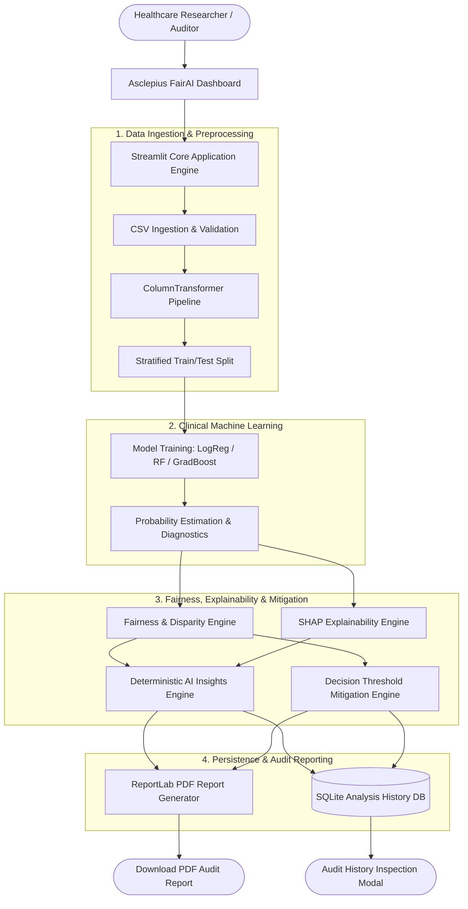

# Asclepius FairAI -- Clinical AI Fairness, Explainability & Audit Platform

[](https://www.python.org/downloads/)
[](LICENSE)
[](https://streamlit.io/)
[](https://scikit-learn.org/)
[](https://shap.readthedocs.io/)
[](https://www.reportlab.com/)

> **Asclepius FairAI is an AI-powered healthcare fairness and explainability platform that evaluates machine-learning models for predictive performance and demographic disparities, explains model behavior using SHAP, tests candidate fairness mitigation strategies, and produces structured audit-style reports.**

---

## Table of Contents
1. [Project Overview](#project-overview)
2. [Problem Statement](#problem-statement)
3. [Proposed Solution](#proposed-solution)
4. [Key Features](#key-features)
5. [Role of AI & Machine Learning](#role-of-ai--machine-learning)
6. [Fairness Analysis Methodology](#fairness-analysis-methodology)
7. [Explainable AI (SHAP)](#explainable-ai-shap)
8. [Fairness Mitigation Workflow](#fairness-mitigation-workflow)
9. [Professional PDF Reporting](#professional-pdf-reporting)
10. [Persistent Analysis History](#persistent-analysis-history)
11. [System Architecture](#system-architecture)
12. [End-to-End Workflow](#end-to-end-workflow)
13. [Technology Stack](#technology-stack)
14. [Project Structure](#project-structure)
15. [Installation & Setup](#installation--setup)
16. [Running the Application](#running-the-application)
17. [Demonstration Walkthrough](#demonstration-walkthrough)
18. [Testing & Quality Assurance](#testing--quality-assurance)
19. [Privacy and Safety](#privacy-and-safety)
20. [Limitations](#limitations)
21. [Future Scope](#future-scope)
22. [License](#license)

---

## Project Overview

In clinical decision support, predictive algorithms are increasingly trained on observational electronic health records (EHR) and clinical registries. However, historical inequities in care access, socioeconomic barriers, and differential diagnostic practices can cause models to learn systematic biases.

**Asclepius FairAI** provides healthcare data scientists, clinical AI researchers, and governance committees with an interactive, end-to-end audit workbench to ingest clinical datasets, train baseline and ensemble models, quantify demographic disparities across 5 core fairness indicators, inspect SHAP feature attributions, test candidate decision threshold calibrations, and generate exportable audit reports.

---

## Problem Statement

Standard diagnostic metrics in clinical machine learning -- such as aggregate ROC-AUC, Accuracy, and Brier Score -- evaluate average population performance but routinely conceal severe subgroup-level disparities:
- **Underdiagnosis Risk**: An overall sensitivity of 85% may conceal a 60% sensitivity in an underserved minority cohort (elevated False Negative Rate).
- **Resource Allocation Disparities**: Unequal positive prediction rates across insurance tiers can bias post-discharge clinical monitoring.
- **Black-Box Opacity**: Complex ensemble models fail to provide explainability for why high-risk alerts are triggered.
- **Small Cohort Misinterpretation**: Naive fairness evaluations on small cohorts (n < 30) produce high statistical variance and false alarms.

---

## Proposed Solution

Asclepius FairAI addresses these challenges through a unified 10-phase auditing pipeline:
1. **Clinical ML Training**: Leakage-free `ColumnTransformer` preprocessing with stratified evaluation across 3 model architectures.
2. **5-Metric Fairness Screening**: Simultaneous evaluation of Demographic Parity, Disparate Impact Ratio, Equal Opportunity, Equalized Odds, and False Negative Rate disparities.
3. **Sample-Size Reliability Tiering**: Automatic statistical validity flagging (n < 30, 30-49, 50+).
4. **SHAP Attribution Engine**: Game-theoretic feature attribution separating clinical predictors from demographic proxies.
5. **Deterministic AI Insights**: Evidence-based clinical recommendations and severity tiering.
6. **Decision Threshold Mitigation**: Post-processing calibration with strict performance preservation constraints.
7. **Audit PDF Reports**: Publication-quality multi-page audit summaries with dynamic pagination and embedded charts.
8. **Privacy-Preserving History**: SQLite persistence storing aggregate metadata with Zero PHI.

---

## Key Features

- **Interactive 9-Section Dashboard**: Modular, single-page reactive interface designed with clinical-grade aesthetics (Emerald Green, Soft Mint, Slate).
- **Leakage-Free Preprocessing**: Automated median/mode imputation, StandardScaler, and OneHotEncoder fitted exclusively on training splits.
- **Identifier Protection**: Automatic detection and exclusion of high-cardinality patient identifiers (UUID, MRN).
- **Multi-Group Sensitive Attributes**: Auditing across binary cohorts (e.g. Male vs Female) and multi-class categories (e.g. Medicare vs Medicaid vs Private).
- **Side-by-Side Trade-off Analytics**: Instant before/after comparison tables highlighting fairness gains versus predictive performance deltas.
- **Two-Pass Dynamic PDF Generator**: Standalone ReportLab engine with `NumberedCanvas` ("Page X of Y"), charts, and clinical disclaimers.
- **In-Memory Analytical Processing**: Zero storage of raw patient-level datasets in databases or disk caches.

---

## Role of AI & Machine Learning

To maintain scientific integrity and transparency, the role of AI in Asclepius FairAI is precisely delineated:

| Operational Component | Computational Role | Implementation |
| :--- | :--- | :--- |
| **Supervised Machine Learning** | Learns predictive patterns from clinical features to output risk probabilities. | Scikit-Learn (Logistic Regression, Random Forest, Gradient Boosting) |
| **Model Performance Evaluation** | Computes classification diagnostics, confusion matrices, and ROC curves. | Standard statistical classification metrics |
| **Algorithmic Fairness Analysis** | Evaluates group-level statistical parity and error-rate disparities across cohorts. | Mathematical disparity screening formulas *(Not an ML model)* |
| **Explainable AI (SHAP)** | Computes game-theoretic marginal feature attributions for global/local outputs. | `shap.TreeExplainer` & `shap.LinearExplainer` |
| **Clinical Insights Engine** | Synthesizes measured findings into deterministic governance recommendations. | Rule-based deterministic logic *(Not a generative black-box)* |
| **Fairness Mitigation Engine** | Evaluates candidate operational decision thresholds to optimize trade-offs. | Continuous probability post-processing |

---

## Fairness Analysis Methodology

Asclepius FairAI evaluates demographic subgroups against **5 locked project screening thresholds**:

| Metric | Screening Threshold | Description & Clinical Objective |
| :--- | :---: | :--- |
| **Demographic Parity Difference (DPD)** | <= 0.05 (5.0%) | Absolute difference in positive selection rates between the highest and lowest group. |
| **Disparate Impact Ratio (DIR)** | 0.80 - 1.25 | Ratio of lowest to highest group selection rate (The Four-Fifths Rule). |
| **Equal Opportunity Difference (EOpD)** | <= 0.05 (5.0%) | Absolute difference in True Positive Rates (Sensitivity / Recall) across groups. |
| **Equalized Odds Difference (EOD)** | <= 0.05 (5.0%) | Maximum of TPR disparity and False Positive Rate (FPR) disparity. |
| **False Negative Rate Disparity (FNRD)** | <= 0.05 (5.0%) | Difference in underdiagnosis rates among actual positive clinical cases. |

### Subgroup Sample-Size Reliability Rules
Statistical conclusions require adequate cohort power. The platform automatically assigns reliability tiers:
- **n < 30 --> *Insufficient Evidence***: Subgroup sample size is below statistical thresholds; disparities are flagged but not declared definitive bias.
- **30 <= n < 50 --> *Caution***: Subgroup size exhibits moderate variance; results should be interpreted cautiously.
- **n >= 50 --> *Standard Evaluation***: Subgroup sample size satisfies standard clinical evaluation requirements.

> *Notice: These screening criteria represent project criteria for algorithmic audit and do not constitute universal regulatory or clinical standards.*

---

## Explainable AI (SHAP)

Asclepius FairAI integrates **SHAP (SHapley Additive exPlanations)** to ensure model transparency:
- **Global Feature Ranking**: Computes mean absolute Shapley values across the evaluation set, ranking top predictive drivers (e.g. ICU length of stay, comorbidity score).
- **Sensitive Attribute Transparency**: Explicitly visualizes whether the protected demographic feature contributes directly to model predictions.
- **Local Waterfall Explanations**: Visualizes single-patient prediction breakdowns showing how individual clinical baseline values push risk probabilities above or below the base value.

---

## Fairness Mitigation Workflow

When meaningful disparities are identified, Asclepius FairAI offers post-processing **Decision Threshold Optimization**:

```
Original Model (theta = 0.50)
        |
        v
Disparity Detected
        |
        v
Candidate Grid Search (theta in [0.20, 0.80])
        |
        v
Performance Guard (Delta BalAcc <= 5 pp)
        |
        v
Optimized Threshold Selected
```

- **Baseline Preservation**: The original model artifact, training pipeline, and baseline metrics (theta = 0.50) are strictly preserved.
- **Performance Constraint**: Automatically rejects any candidate threshold where Balanced Accuracy drops by > 5 percentage points relative to baseline.
- **ROC-AUC Invariance**: The platform transparently explains why ROC-AUC remains unchanged (continuous rank-ordering is threshold-invariant).

---

## Professional PDF Reporting

The built-in ReportLab compilation engine produces publication-ready audit reports:
- **Executive Summary Header**: Analysis ID, timestamp, model metadata, and overall screening verdict.
- **Dataset & Model Cards**: Class prevalence, test-train splits, and confusion matrix heatmap.
- **Fairness & Subgroup Tables**: Complete breakdown of TPR, FPR, FNR, and selection rates per demographic cohort.
- **Embedded Visualizations**: In-memory Matplotlib charts rendered directly into the PDF stream.
- **Candidate Mitigation Section**: Side-by-side Before/After evaluation table (included when mitigation is executed).
- **Two-Pass NumberedCanvas**: Dynamic footer with "Page X of Y" and institutional disclaimers.

---

## Persistent Analysis History

Analysis runs can be saved to an embedded SQLite database (`outputs/history.db`):
- **Zero PHI**: Stores only aggregate performance metrics, fairness scores, SHAP summaries, and recommendation strings.
- **SQL Injection Defense**: 100% parameterized SQL bindings.
- **Deduplication**: Automatically updates matching records if re-analyzed within 5 minutes.
- **Interactive Modal**: Allows instant retrospective inspection of past models and reports.

---

## System Architecture



---

## End-to-End Workflow

```
Landing Page
    |
    v
Audit Dashboard
    |
    v
Upload Dataset ---------> Automated Column Type & ID Validation
    |
    v
Configure Attributes ---> Select Binary Target & Protected Demographic Group
    |
    v
Preprocessing ----------> Missing Value Imputation, Scaling & One-Hot Encoding
    |
    v
Model Training ---------> Stratified Train/Test Split (LogReg / RF / GradBoost)
    |
    v
Performance Evaluation -> Accuracy, Balanced Acc, Sensitivity, Specificity, ROC-AUC, CM
    |
    v
Fairness Auditing ------> DPD, DIR, EOpD, EOD, FNR Disparities & Reliability Tiering
    |
    v
SHAP Explainability ----> TreeExplainer / LinearExplainer Feature Importance
    |
    v
AI Insights ------------> Rule-Based Severity Tiers & Actionable Governance Steps
    |
    v
(Optional) Mitigation --> Candidate Decision Threshold Optimization
    |
    v
Before/After Audit -----> Side-by-Side Trade-off & Cohort Shift Analytics
    |
    v
PDF Report Generation --> Multi-Page Audit Document with Embedded Heatmaps
    |
    v
Analysis History -------> Parameterized SQLite Storage & Retrospective Review
```

---

## Technology Stack

- **Frontend & App Framework**: Streamlit, HTML5, CSS3, JavaScript (ES6+), FontAwesome 6
- **Data & Machine Learning**: Python 3.10+, Pandas, NumPy, Scikit-Learn, Fairlearn
- **Explainability**: SHAP (SHapley Additive exPlanations)
- **Document Generation**: ReportLab (PDF Engine), Matplotlib (Agg Backend)
- **Persistence**: SQLite3 (Standard Library)
- **Quality Assurance**: Unittest

---

## Project Structure

```
ASCLEPIUS_FAIR_AI/
│
├── assets/
│   ├── css/
│   │   ├── animations.css
│   │   ├── responsive.css
│   │   └── style.css
│   ├── images/
│   │   └── hero-illustration.png
│   └── js/
│       ├── animations.js
│       └── script.js
│
├── data/
│   ├── demo/
│   │   └── synthetic_clinical_demo.csv
│   └── synthetic_healthcare_icu_readmission.csv
│
├── docs/
│   ├── DEMO_SCRIPT.md
│   ├── FINAL_CHECKLIST.md
│   ├── PRESENTATION_TALKING_POINTS.md
│   ├── SCREENSHOT_CHECKLIST.md
│   └── TESTING.md
│
├── outputs/
│   ├── history.db
│   └── reports/
│
├── scratch/
│   ├── test_full_pipeline_e2e.py
│   ├── test_phase9_mitigation.py
│   └── test_phase10_production_readiness.py
│
├── src/
│   ├── core/
│   │   ├── explainability.py
│   │   ├── fairness.py
│   │   ├── history.py
│   │   ├── insights.py
│   │   ├── mitigation.py
│   │   ├── preprocess.py
│   │   ├── report_generator.py
│   │   └── train_model.py
│   ├── ui/
│   │   ├── cards.py
│   │   ├── loader.py
│   │   ├── navbar.py
│   │   └── sidebar.py
│   ├── app.py
│   └── config.py
│
├── templates/
│   ├── components/
│   │   └── dashboard.html
│   └── pages/
│       └── home.html
│
├── .gitignore
├── requirements.txt
└── README.md
```

---

## Installation & Setup

### Prerequisites
- Python 3.10, 3.11, or 3.12 installed
- Git installed (optional)

### Clean Setup Steps

1. **Clone or Download the Repository**:
   ```bash
   git clone https://github.com/your-org/asclepius-fair-ai.git
   cd asclepius-fair-ai
   ```

2. **Create and Activate a Virtual Environment** (Recommended):
   ```bash
   # Windows PowerShell
   python -m venv venv
   .\venv\Scripts\Activate.ps1

   # macOS / Linux
   python3 -m venv venv
   source venv/bin/activate
   ```

3. **Install Dependencies**:
   ```bash
   python -m pip install --upgrade pip
   python -m pip install -r requirements.txt
   ```

---

## Running the Application

Launch the interactive workbench via Streamlit:

```bash
python -m streamlit run src/app.py
```

The application will launch automatically in your default browser at:
**`http://localhost:8501`**

---

## Demonstration Walkthrough

A pre-packaged, 100% synthetic demonstration dataset is provided in `data/demo/synthetic_clinical_demo.csv`.

1. Launch the app and click **"Get Started"**.
2. In Section 1, upload `data/demo/synthetic_clinical_demo.csv`.
3. Select **Target Column**: `readmitted_30d` and **Sensitive Attribute**: `gender`.
4. Choose **Random Forest** and click **"Train Clinical Model & Run Audit"**.
5. Inspect the generated **Performance Metrics**, **Fairness Disparities**, and **SHAP Importance**.
6. Navigate to Section 9 (**Mitigation**), review the candidate threshold table, and select the optimal trade-off threshold.
7. Click **"Generate Audit PDF Report"** and **"Save Analysis to History"**.

---

## Testing & Quality Assurance

Run the master test suites from the project root:

```bash
# Run Phase 10 Master Production Readiness Test Suite (35 Tests)
python scratch/test_phase10_production_readiness.py

# Run Phase 9 Mitigation & Trade-off Test Suite (17 Tests)
python scratch/test_phase9_mitigation.py

# Run Full 10-Phase End-to-End Pipeline Integration Test
python scratch/test_full_pipeline_e2e.py
```

---

## Privacy and Safety

- **Zero Protected Health Information (PHI)**: Asclepius FairAI is designed strictly for synthetic, public, or fully de-identified clinical datasets. Do not upload live PHI.
- **Zero-Storage Architecture**: Raw dataset records are processed strictly in volatile memory. The SQLite database stores only aggregate statistical metrics and serialized metadata.
- **Non-Diagnostic Decision Support**: Asclepius FairAI is a research, auditing, and educational workbench. Model outputs and fairness metrics do not constitute autonomous medical diagnoses or clinical directives.
- **No Direct Proof of Bias**: Statistical disparity screening highlights areas requiring domain-expert review and does not automatically prove unlawful discrimination or clinical negligence.
- **Non-Causal SHAP**: Feature attributions generated by SHAP represent mathematical associations within the trained model, not causal biological or clinical mechanisms.
- **No HIPAA Compliance Claim**: Asclepius FairAI does not claim formal HIPAA certification.

---

## Limitations

1. **Data Dependency**: Auditing outcomes directly reflect the quality, labeling accuracy, and demographic representation of the uploaded dataset.
2. **Post-Processing Mitigation**: Decision threshold adjustment calibrates operational decision cut-points but does not repair historical label bias or unmeasured confounding in training data.
3. **Subgroup Sample Power**: Subgroups with n < 30 cannot support definitive fairness conclusions due to high variance.
4. **Intersectional Limitations**: Single-attribute screening does not capture high-dimensional intersectional disparities (e.g. race x gender x age) simultaneously.
5. **Synthetic Benchmarks**: Synthetic demo datasets simulate clinical patterns for demonstration purposes and cannot establish real-world clinical efficacy.

---

## Future Scope

- **In-Processing Mitigation**: Implementation of adversarial debiasing and fair representation learning algorithms.
- **Intersectional Auditing**: Multi-attribute subgroup disparity matrix evaluations.
- **HL7 / FHIR Ingestion**: Native connectors for secure, standardized clinical data interoperability.
- **Continuous Monitoring**: Streaming drift detection and longitudinal bias tracking for deployed clinical models.

---

## License

This project is licensed under the **MIT License**.
